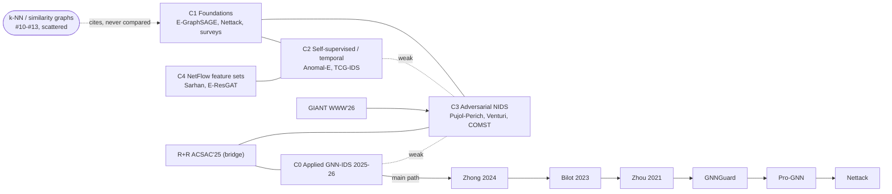

# Literature review: graph construction, baselines and adversarial attacks in GNN-based NIDS

*Review date: 2026-10-12. Scope: GNN-based network intrusion detection (2018–2026), with three questions:*

1. *Feature-similarity (k-NN / top-k) flow graphs. What do papers report, under which protocol and against which baselines? Has anyone shown that the graph adds nothing?*
2. *Endpoint/host graphs. Is there evidence that they beat tabular baselines? Which evaluation critiques exist (identity leakage, dataset artefacts, reproducibility)?*
3. *Adversarial attacks on GNN NIDS: feature-only, structure-only, joint, and any decomposition of feature and structure effects.*

*Purpose: to check overlap and novelty for the three candidate contributions in `docs/PAPER_ROADMAP.md`:*

- *(a) a negative result on k-NN feature graphs;*
- *(b) joint problem-space feature-and-structure attacks on endpoint-graph GNNs, evaluated with the A/B/C decomposition;*
- *(c) graph construction as a defence.*

*Graph, scripts and knowledge graph: [`docs/lit-graph/gnn-nids/`](lit-graph/gnn-nids/).*

---

## 1. Executive summary

**(a) The k-NN negative result has been partly pre-empted, but its mechanism and adversarial consequence are open.**
- A 2026 preprint, not peer reviewed (#10), already reports that feature-similarity graphs give "no reliable advantage over Random Forest" on CICIoMT2024, while communication-topology graphs help on topology-heavy attacks.
- Two re-evaluations of graph-based NIDS make the general "complexity must beat a simple control" point: ACSAC 2025 (#8) and an arXiv 2026 preprint (#9).
- None of the three studies supervised flow classifiers on NetFlow-v3 under a chronological split. None removes the edges to show *why* similarity graphs are redundant, and none studies what that redundancy means for attacks.
- In the k-NN papers themselves, the property matrix (§8) finds no edge-removal ablation, no same-split tabular baseline among those read in full, and no adversarial evaluation.

**(b) Joint attacks are no longer new. A decomposition of feature and structure effects is.**
- GIANT (WWW 2026, #6) explicitly lists "lack of joint consideration for feature and topology manipulations" as a gap. It fills it with *injected* flows whose endpoints and features are optimised together. It never modifies the attacker's own malicious flows and never separates the two effects.
- Venturi et al. (#4) evaluate feature and structural attacks *separately*. They conclude that GNNs resist feature attacks but break under structural ones.
- No paper measures how much of the damage comes from features, how much from structure, and how much from their interaction. None asks whether evaluating them separately misjudges the deployed system.
- That decomposition, combined with an attacker who can both shape its own flows and inject new ones under a single traffic-cost budget, remains open.

**(c) Graph construction as a defence is open in the NIDS literature.**
- The existing defences are adversarial training (#5) and a homophily filter borrowed from GNNGuard (in #6).
- No NIDS paper treats the construction choices themselves (what a node is, window length, degree caps) as a defence.
- Outside NIDS, one general-GNN defence uses k-NN-augmented construction (#30).

**Evaluation hygiene is a recognised problem, which supports the protocol contribution.** This covers reproducibility (#8, #9), identity leakage (E-GraphSAGE remaps source IPs, #1; Pujol-Perich avoid IP identifiers, #3) and shortcut features (#23, and our TTL finding). But none of the endpoint-graph GNN papers read in full uses a chronological split together with same-split XGBoost baselines.

---

## 2. Paper discovery summary

| Item | Value |
|---|---|
| Access channels | **A (open APIs):** OpenAlex worked from the laptop (rate-limited late in the session); arXiv API worked; Semantic Scholar returned HTTP 429, so it was not used and SPECTER2 relevance was replaced by keyword scoring. **B (institutional):** IEEE Xplore through Pedro's Chrome, "Access provided by: b-on: Universidade Nova de Lisboa", used for R+R (#8). **ACM DL** is open access; GIANT's full text was read in the ACM reader. MDPI, preprints.org and HAL were read in the browser because they block scripted access. |
| Seeds | 31 resolved (§10), surveys first, plus the most-cited primary works and 2024–2026 papers. |
| Expansion | 1 hop. Backward: all references of the seeds. Forward: the 200 most-cited and the 100 most-recent citing works of every seed with citations. 2,717 works harvested. |
| Pruning | Keyword relevance ≥ 5 (graph, IDS, flow, adversarial, GNN, problem-space, k-NN terms) **and** (linked to ≥ 2 seeds, or ≥ 30 citations, or year ≥ 2024). **556 candidates, 1,981 citation edges.** |
| Core set | 31 papers. **Full text read:** #1, #2, #3, #4, #5, #6, #8, #9, #10, #11 and the NetFlow-v3 dataset paper (#22). The rest are abstract-level (flagged in §3). |
| Not accessible | GIANT is not in OpenAlex (resolved through the ACM DL). The ITASEC 2023 PDF has no extractable text in Chrome (abstract only). *AI Review* 2026 survey: the Springer page returned no text (abstract not obtained, excluded). Zhong et al. 2024 survey (#16): abstract and citation-graph position only. |
| Venue quality | Scimago quartiles were **not re-verified** in this session. Venue tiers in §3 are from general knowledge and should be checked before submission. Preprints and workshop papers are flagged. |

---

## 3. Overview table

PR = PageRank rank among the 556 candidates ("—" = outside the candidate set: too new or not indexed). C = citation community (§4). Access: **F** = full text read, **I** = institutional full text, **A** = abstract or secondary.

| # | Title (short) | First author | Year | Venue | Tier | C | PR | Access | Key contribution |
|---|---|---|---|---|---|---|---|---|---|
| 1 | E-GraphSAGE | Lo | 2022 | IEEE/IFIP NOMS | top netw. conf | 1 | 2 | F | Endpoint flow graph with edge features; random 70/30 split; compared with *reported* numbers |
| 2 | Anomal-E | Caville | 2022 | Knowledge-Based Systems | Q1 | 2 | 5 | F | Self-supervised edge embeddings; embeddings vs raw features on the same data |
| 3 | Unveiling the potential of GNNs for robust ID | Pujol-Perich | 2022 | ACM SIGMETRICS PER | workshop-level | 3 | 6 | F | Host-connection graph; accuracy similar to MLP/AdaBoost/RF; robust to packet-size/IAT shifts |
| 4 | Problem space structural adversarial attacks | Venturi | 2024 | arXiv | preprint | — | 360 | F | First problem-space structural attacks; feature and structural attacks evaluated separately |
| 5 | Defending GNN NIDS against structural attacks | Venturi | 2025 | IEEE NCA | conf | 3 | 241 | F | Adversarial training against edge and node injection |
| 6 | GIANT | Zhao | 2026 | ACM WWW | top conf | — | — | F | Injection-only attack, jointly optimising endpoints and features of injected flows |
| 7 | Towards problem space-constrained attacks | Mouzaoui | 2025 | RESSI | workshop | — | — | A | Greedy (weakly submodular) connection injection; alarm fatigue |
| 8 | R+R: From Claims to Crashes | Wang | 2025 | ACSAC | top sec conf | 0 | 488 | I | Re-evaluation of 5 unsupervised GIDS; up to 40% metric swings; 2 edges evade |
| 9 | A First-Principles Evaluation of GIDS | (see URL) | 2026 | arXiv | preprint | — | — | F | GIDS-Eval; encoder-free control ranks first on 2/4 datasets |
| 10 | From Flow Features to Communication Topology (IoMT) | (see URL) | 2026 | Preprints.org | preprint | — | 369 | F | Feature-similarity graphs ≈ RF; topology graphs help on topology-heavy attacks |
| 11 | TKSGF: attribute-based graph construction | (MDPI) | 2025 | Information | MDPI | 1 | 41 | F | Top-k similarity graph; compared with reported results; metric/threshold ablation only |
| 12 | BS-GAT | (Cybersecurity) | 2025 | Cybersecurity | journal | 2 | 42 | A | Behaviour-similarity flow graph with GAT |
| 13 | GCN-LOF | (Comput. Netw.) | 2025 | Computer Networks | Q1 | 2 | 100 | A | k-NN graph + GCN embeddings + LOF |
| 14 | Hierarchical adversarial attacks on GNN IoT NIDS | Zhou | 2021 | IEEE IoT Journal | Q1 | 1 | 12 | A | Shadow-model feature attacks |
| 15 | GNNs for Intrusion Detection: A Survey | Bilot | 2023 | IEEE Access | journal | 1 | 4 | A | Survey (bridge node) |
| 16 | A survey on GNNs for IDS | Zhong | 2024 | Computers & Security | Q1 | 0 | 7 | A | Survey (bridge node) |
| 17 | Practical Evaluation of GNNs in NIDS | Venturi | 2023 | ITASEC (CEUR) | workshop | — | — | A | Online deployment constraints shrink reported performance |
| 18 | Dos and Don'ts of ML in Computer Security | Arp | 2022 | USENIX Security (arXiv v.) | top sec conf | 3 | 148 | A | Pitfalls: spurious correlations, temporal snooping, inappropriate baselines |
| 19 | Intriguing properties of adversarial ML attacks in the problem space | Pierazzi | 2020 | IEEE S&P | top sec conf | — | — | A | Problem-space formalism used by #4, #5 |
| 20 | Modeling realistic adversarial attacks against NIDS | Apruzzese | 2022 | ACM DTRAP | journal | — | — | A | Realistic threat models for NIDS evasion |
| 21 | Towards a Standard Feature Set for NIDS datasets | Sarhan | 2021 | MONET | journal | 4 | 3 | A | NetFlow feature sets (precursor of NetFlow-v3) |
| 22 | Temporal Analysis of NetFlow Datasets (NetFlow-v3) | Luay | 2025 | arXiv:2503.04404 | preprint | — | — | F | NetFlow-v3 datasets with timestamps |
| 23 | Unmasking Shortcut Learning in IoT ID | (arXiv) | 2026 | arXiv:2609.28725 | preprint | — | — | A | LightGBM ≈ RF ≈ MLP on behavioural features; timestamp/IP shortcuts |
| 24 | Adversarial Attacks on NNs for Graph Data (Nettack) | Zügner | 2018 | KDD | top ML conf | 1 | 8 | A | Foundational structure/feature graph attacks |
| 25 | GNNGuard | Zhang | 2020 | NeurIPS (arXiv v.) | top ML conf | 1 | 32 | A | Similarity-based edge pruning defence (used in #6) |
| 26 | Graph Structure Learning for Robust GNNs (Pro-GNN) | Jin | 2020 | KDD | top ML conf | 1 | 79 | A | Learn the graph as a defence |
| 27 | Dynamic line graph NN for ID | (TIFS) | 2022 | IEEE TIFS | Q1 | 1 | 11 | A | Line-graph representation |
| 28 | TCG-IDS | Wu | 2025 | IEEE TIFS | Q1 | 2 | 67 | A | Temporal contrastive graph NIDS (claims robustness) |
| 29 | Applying SSL to NIDS flows with GNNs | Xu | 2024 | Computer Networks | Q1 | 2 | 14 | A | Self-supervised edge-feature GNN |
| 30 | Mitigating the Structural Bias in Graph Adversarial Defenses | (arXiv) | 2025 | arXiv:2504.20848 | preprint | — | — | A | k-NN-augmented construction as a general GNN defence (not NIDS) |
| 31 | Automating Botnet Detection with GNNs | Zhou | 2020 | arXiv | preprint (adopted) | 1 | **1** | A | Topology-only botnet GNN; highest PageRank in the set |

---

## 4. Thematic taxonomy (graph-derived)

Communities come from Louvain on the bibliographic-coupling graph (seed 42). Each is named from its top-PageRank members and title terms. Sizes and recency are over the 556 candidates.

| C | Name | Papers | Median year | Share 2025–26 | Representative members |
|---|---|---|---|---|---|
| 0 | **Applied GNN-IDS wave** (IoT, dynamic, federated) | 159 | 2025 | 89% | #16, GNN-IDS 2024, many MDPI/Sci. Reports |
| 1 | **Foundations: endpoint-graph GNN NIDS + graph adversarial ML** | 108 | 2024 | 30% | #1, #15, #24, #14, #27, #31, #25, #26 |
| 2 | **Self-supervised / temporal flow-graph GNNs** | 88 | 2025 | 70% | #2, #29, #28, #12, #13, PPT-GNN, 3D-IDS |
| 3 | **Adversarial ML for NIDS (feature space)** | 84 | 2025 | 61% | #3, COMST survey, #18, #5 |
| 4 | **NetFlow feature sets and edge-feature GNN variants** | 80 | 2026 | 75% | #21, E-ResGAT, flow-topology GCN, FN-GNN, ARGANIDS |
| 5 | In-vehicle CAN-bus graph IDS (out of scope) | 12 | 2024 | 42% | — |

The k-NN/similarity papers do not form their own community. They are spread across C0, C1 and C2 (TKSGF in C1; BS-GAT and GCN-LOF in C2). They cite the endpoint-graph foundations (E-GraphSAGE, the surveys) but do not compare against them. This is how a representation question has stayed unexamined: there is no sub-literature that owns it.

---

## 5. Methods and tools analysis

**C1 (foundations).**
- E-GraphSAGE (#1) is the reference model, with endpoints as nodes and flows as edges. It reached F1 1.0 on NF-ToN-IoT and 0.97 on NF-BoT-IoT under a random 70/30 split, compared against the best results *reported by other papers*.
- The graph adversarial ML in this community (#24–#26) comes from citation and social graphs. Its threat models assume direct edge edits, which #4 and #6 argue are infeasible in NIDS.

**C2 (self-supervised/temporal).** These papers (#2, #28, #29) mainly compare GNN embeddings with raw features inside the same anomaly detector (#2), or against other GNNs. Robustness claims (#28) are rarely tested against structural attackers. C2 has the weakest citation links to C3 (§6), which is the structural hole.

**C3 (adversarial NIDS).**
- The problem-space formalism comes from #19, and realistic threat models from #20.
- For GNNs, the consensus is that endpoint-graph GNNs resist feature perturbations better than RF/MLP (#3, #4) but fail under small structural injections (#4, #5, #6, #8, #9).
- Budgets are counted in injected flows or edges: 1 per compromised node (#4), 2 edges (#8, #9), up to 10,000 flows (#6). Feature budgets are fixed increments (#4) or standardised units (#9).

**C4 (NetFlow, edge features).** The NetFlow standard feature sets (#21) and their v3 timestamped successors (#22) are the de facto benchmark family. Most C4 papers use random splits.

**Similarity-graph line (#10–#13, plus #30 outside NIDS).**
- Construction: cosine top-k (#11, #10 with k = 10), FAISS retrieval (#11), behaviour rules (#12), k-NN + LOF (#13).
- Reported numbers are high, but #11 compares against *reported* results, and its ablation only varies the similarity metric and threshold.
- Only #10, a preprint on one dataset, runs the representation comparison against Random Forest.

---

## 6. Relationship map

**Main path** (search-path-count weights, citing → cited): applied 2025–26 GIDS → Zhong 2024 survey (#16) → Bilot 2023 survey (#15) → Zhou 2021 hierarchical attacks (#14) → GNNGuard (#25) → Pro-GNN (#26) → Nettack (#24). The field's backbone links applied GNN-IDS work to graph adversarial ML *through the surveys*, not through NIDS-specific attack papers.

**Bridges** (betweenness on the coupling graph): the two surveys (#15, #16), a 2025 scoping review of GNN traffic analysis, and **R+R (#8)**. The re-evaluation already connects otherwise separate communities.

**Cross-citation density** (edges per 100 node pairs): C0–C3 0.52, C2–C3 0.54, C3–C5 0.30. The applied and self-supervised GNN communities rarely cite the adversarial-NIDS community.

**Competing paradigms.** Endpoint/host graphs (structure from addresses) against feature-similarity graphs (structure from features). The literature treats them as interchangeable "graph representations". Only #10 compares them directly, and our pilot (§8) shows they behave very differently.

**Convergent findings.**
1. Graph models are robust to feature-only perturbations, but only when the structure carries independent information (#3, #4). Our k-NN pilot shows the opposite case: there, the graph adds nothing.
2. Tiny structural injections break endpoint-graph GNNs (#4, #6, #8, #9).
3. Under a matched protocol, simple controls match or beat complex graph models (#3 clean accuracy, #9, #10, #23).

---

## 7. Key papers deep-dive

**#6 GIANT (WWW 2026): the closest competitor for (b).**
- Threat model: injection only, from compromised hosts, on-path or off-path. Existing traffic is never altered; the authors argue that altering it needs privileged access.
- Method: a "hypothetical line graph" surrogate (LineGraphSAGE). Endpoints are chosen by heuristic degree rules, then the features of the injected flows are optimised by gradient with plausibility bounds.
- Targets: E-GraphSAGE, TS-IDS, Anomal-E, E-ResGAT, plus a homophily filter. Data: ToN-IoT and CIC-IDS2018-v2, random 80/20 per attack type, 1:15 imbalance. Budgets of 1,000 to 10,000 injected flows.
- **What it does not do:** modify the attacker's own malicious flows; decompose effects; use a chronological split; compare with tabular models; include k-NN graphs.

**#4 Venturi et al. 2024 (arXiv): the closest competitor for the separate-evaluation claim.**
- Formalises the problem-space constraints for structural attacks: additions only, plausibility, robustness to preprocessing.
- Feature attacks (fixed increments of duration, bytes and packets) barely affect E-GraphSAGE or LineGraphSAGE, while Random Forest collapses.
- Structural C2x attacks: a single injected benign flow per compromised node collapses E-GraphSAGE.
- **Feature and structural attacks are never combined.** The "robust to features" and "fragile to structure" conclusions come from separate experiments. That is exactly the evaluation practice the A/B/C decomposition questions.

**#8 R+R (ACSAC 2025) and #9 First-Principles (arXiv 2026): the evaluation-critique line.**
- Both study *unsupervised temporal host-graph* GIDS (Euler, Argus, VGRNN, PIKACHU, Anomal-E) on LANL, OpTC, CIC-IDS2017, CTU-13 and enterprise traces.
- Reported findings:
  - snapshot windows swing AP by 38.3% on average (#9);
  - preprocessing alone moves AP by up to 61.8 points (#9);
  - two crafted edges give full evasion (#8, #9);
  - an encoder-free PCA control ranks first by AP on 2 of 4 datasets (#9).
- Neither covers supervised flow classification, NetFlow-v3, feature-similarity graphs or XGBoost. Both support our framing that *added graph complexity must be justified against a simple control under a matched protocol*.

**#10 IoMT topology preprint (2026): the closest competitor for (a).**
- One dataset (CICIoMT2024), classifying 500-flow windows by majority vote.
- Graphs: k = 10 cosine edges plus protocol-homophily edges, against PCAP communication-topology graphs and a window-level Random Forest.
- Findings: similarity graphs are not reliably better than RF. Topology graphs are competitive on DDoS, DoS and reconnaissance (macro-F1 0.800 ± 0.026 vs 0.784 ± 0.020). Gains shrink under session-aware splits.
- **Not covered:** node-level flow classification, NetFlow benchmarks, an edge-removal or random-graph mechanism, or any adversarial analysis.

**#3 Pujol-Perich (2022): the origin of the "GNNs are robust" claim.** The host-connection graph (host and flow nodes, hosts initialised to ones) reaches accuracy *similar* to MLP, AdaBoost, RF and ID3 on CIC-IDS2017. The benefit is robustness to packet-size and inter-arrival-time shifts. The structure is address-derived, so feature perturbations cannot rewire it. This is the opposite regime to k-NN graphs.

**#1 E-GraphSAGE (2022): the most-cited endpoint GNN.**
- Random 70/30 split.
- Source IPs are randomly remapped because, in the authors' words, attacks come from "only a small number of IP addresses". This acknowledges identity leakage.
- Comparison is with results reported elsewhere, not with same-split XGBoost.

**#11 TKSGF (2025): a typical k-NN-graph paper.** It argues similarity graphs beat "physical network connections". Its evidence is a table of results reported by other papers, and its ablation varies the similarity metric and threshold but never removes the graph.

---

## 8. Research gap analysis

The property matrix comes from `build_kg.py` / `gap_matrix.json`: for each graph family, the number of core papers with the property. Our own pilot is listed for comparison.

| Family (papers) | Same-split tabular | Edge ablation | Identity control | Feature attack | Structural attack | Joint attack | Decomposition | Construction defence |
|---|---|---|---|---|---|---|---|---|
| k-NN / similarity (5) | 1 (#10, RF, window-level) | **0** | 0 | **0** | **0** | 0 | **0** | 0 |
| Endpoint/host, supervised (9) | 3 | **0** | 2 | 3 | 4 | 1 (injection-only, #6) | **0** | **0** |
| Line graph (2) | 1 | 0 | 0 | 1 | 2 | 1 | 0 | 0 |
| Temporal host GIDS (2) | 2 | 1 (#9, encoder-free) | 0 | 1 | 2 | 0 | 0 | 0 |
| *This repo's pilot* | *yes (XGBoost, MLP)* | *yes (none/random)* | *TTL, IDs dropped* | *yes* | *induced (rebuild)* | *no* | *yes (A/B/C)* | *planned* |

**GAP #1: no mechanism or adversarial analysis for feature-similarity graphs.**
- *Type:* methodological and evaluation.
- *Graph evidence:* the k-NN papers are scattered across C0–C2, with no community of their own (§4). They cite the endpoint-graph foundations but never compare against them, and the matrix row has 0 ablations and 0 attacks.
- *Evidence papers:* #10 (the only comparison, preprint, single dataset, window-level), #11–#13.
- *Description:* nobody shows *why* similarity graphs add nothing: neighbours are near-copies, so removing edges changes 0.2–1.2% of predictions while random neighbours collapse F1. Nobody shows the adversarial consequence: perturbations rewire 14–38% of neighbourhoods with no effect. And nobody does this on NetFlow-v3 against XGBoost under a chronological split.
- *Difficulty:* low (done in the pilot). *Impact:* medium; it explains a popular design choice and pre-empts a class of robustness claims.
- *How verified:* OpenAlex title/abstract searches for k-NN/similarity + GNN + intrusion (14 hits in the 2,717-work harvest, §5); a web search for "feature-similarity graph … no advantage over random forest"; and the full text of #10 and #11.

**GAP #2: no decomposition of feature, structure and interaction effects for GNN NIDS.**
- *Type:* evaluation.
- *Graph evidence:* the decomposition column is 0 in every family.
- *Evidence papers:* #4 (separate experiments), #6 (joint but injection-only, with component ablation), #8 and #9 (structure-only evasion), #3 (feature-only).
- *Description:* the field's main claim, "robust to features, fragile to structure", rests on separate experiments. Nobody measures A, B, C and C* for the same perturbation, or tests whether evaluating them separately misjudges the deployed system.
- *Difficulty:* low to medium; `src/analysis/decomposition.py` exists and needs an endpoint-graph adapter. *Impact:* high, because it directly qualifies the conclusions of #3 and #4.
- *How verified:* full-text checks of #4 and #6 for "joint", "decompos" and "ablation"; reading #8's RQ5 and #9's §5.5.

**GAP #3: no attacker that both shapes its own flows and injects new ones under one traffic-cost budget.**
- *Type:* threat model.
- *Evidence:* #6 is injection-only by design; #4 and #5 exclude feature-space changes in their structural threat model; #3 is feature-only.
- *Description:* a real compromised host can pad and delay *its own* malicious flows (which changes edge features) *and* open decoy connections (which changes structure). Their combined cost, measured in extra flows, bytes and delay, has not been optimised or reported.
- *Difficulty:* medium. *Impact:* high, but the framing must be defended against GIANT's argument that altering traffic needs privileged access. For an attacker's *own* traffic it does not.
- *How verified:* GIANT §1 and §4.1 (full text); Venturi 2025 threat model (§III-A, full text).

**GAP #4: graph construction as a defence is untested in NIDS.**
- *Type:* methodological.
- *Graph evidence:* the construction-defence column is 0. The only defences are adversarial training (#5) and a GNNGuard-style homophily filter (#6, citing #25).
- *Description:* construction choices (IP vs IP:port nodes, snapshot length, degree caps, minimum edge weight, excluding external endpoints) change both clean accuracy (#8, #9: the window swings AP by 38%) and the attack surface. Nobody has mapped that trade-off against attacks.
- *Difficulty:* medium. *Impact:* medium to high, because it is deployable without retraining-heavy machinery.
- *How verified:* web search for construction-as-defence in GNN NIDS (only #5 and the general-GNN #30 returned); #5 related work §II-D (full text).

**GAP #5: endpoint-graph GNNs lack a leakage-controlled, chronological, same-split comparison with XGBoost on NetFlow-v3.**
- *Type:* evaluation and dataset.
- *Evidence:* #1 (random split, reported baselines, IP remapping), #4 and #6 (random 80/20), #10 (one IoMT dataset); #22 provides timestamps that are not used for splits in the GNN papers read.
- *Difficulty:* low to medium. *Impact:* medium. It is the prerequisite for Part 2 of the paper, and the result may go either way.
- *How verified:* split protocols in the full texts of #1, #3, #4, #6, #11; the NetFlow-v3 dataset paper (#22).

**Not gaps (already covered):**
- reproducibility of unsupervised GIDS (#8, #9);
- structural injection attacks on endpoint graphs (#4, #6, #7);
- adversarial training against structural attacks (#5);
- joint optimisation of *injected* flows (#6).

---

## 9. Publishable research avenues

**AVENUE #1 (recommended): "Robust to features, fragile to structure?" A decomposition of adversarial effects in graph-based NIDS.**
- *Target venues:* Computers & Security; IEEE TIFS or TDSC (stretch); ACSAC or RAID (conference route).
- *Research question:* for GNN NIDS, does evaluating feature and structure attacks separately misjudge the robustness of the deployed system, and does the answer depend on where the graph comes from?
- *Approach:* two graph families under one NetFlow-v3 protocol (chronological 60/20/20, TTL and identifiers removed, XGBoost and MLP baselines on the same split):
  - **feature-derived k-NN graphs** (the current pipeline);
  - **endpoint graphs** (E-GraphSAGE-style, with anonymised, featureless nodes).
- For each, run the A/B/C/C* decomposition with an attacker who can (i) shape its own malicious flows and (ii) inject decoy flows, under a traffic-cost budget (extra flows, bytes, delay). Compare against GIANT-style injection-only and Venturi-style separate evaluation.
- *Novelty claim:*
  - the first decomposition of feature, structure and interaction effects for GNN NIDS;
  - the first attacker combining own-flow shaping with injection under one budget;
  - and the explanation of why feature-derived graphs give no structural robustness while address-derived graphs give it but expose an injection surface.
- *Contributions:*
  1. protocol and artefact controls;
  2. Part 1, the k-NN mechanism result (GAP #1);
  3. Part 2, endpoint graphs vs XGBoost under the same protocol (GAP #5);
  4. the decomposition (GAP #2) with the joint attacker (GAP #3).
- *Feasibility:* high. The decomposition code, NetFlow-v3 loader, baselines and k-NN pilot exist. New work: an endpoint-graph model and data path, a line-graph adapter for the decomposition, and the injection plus self-shaping attacker.
- *Effort:* 6–8 weeks. *Building on:* #4, #6, #3, #10, #19.

**AVENUE #2: Graph construction as a training-free defence for endpoint-graph NIDS.**
- *Target:* Computer Networks, IEEE TNSM, or a section of AVENUE #1.
- *Question:* which construction choices trade little clean F1 for large robustness to injection? Candidates: IP vs IP:port nodes, window length, degree cap, external-endpoint policy, minimum flows per edge.
- *Novelty:* GAP #4.
- *Feasibility:* high, once AVENUE #1's endpoint pipeline exists. *Effort:* 3–4 weeks on top of #1.

**AVENUE #3: a short negative-result paper on feature-similarity graphs.**
- *Target:* a workshop, or a letter (e.g. IEEE Networking Letters, IEEE Communications Letters).
- *Content:* the k-NN mechanism, the ablation and the adversarial consequence across NetFlow-v3 datasets and k values.
- *Risk:* #10 already makes the headline claim, so this needs to stress the mechanism and the attacks. It is better as Part 1 of AVENUE #1 than as a standalone paper.

**AVENUE #4: CTU-13 cross-scenario evaluation.** Train on some botnet scenarios and test on others with unseen infected hosts. This is the cleanest identity-leakage control for endpoint graphs. It fits inside AVENUE #1 as the third dataset, and gives a comparison point with #4 and #5, which use CTU-13 with random splits.

---

## 10. Full reference list

All entries were resolved in this session (OpenAlex record, arXiv record, or landing page). The numbers match §3.

1. W. W. Lo, S. Layeghy, M. Sarhan, M. Gallagher, M. Portmann. *E-GraphSAGE: A Graph Neural Network based Intrusion Detection System for IoT.* IEEE/IFIP NOMS 2022. https://doi.org/10.1109/noms54207.2022.9789878 (arXiv:2103.16329)
2. E. Caville, W. W. Lo, S. Layeghy, M. Portmann. *Anomal-E: A self-supervised network intrusion detection system based on graph neural networks.* Knowledge-Based Systems 258, 2022. https://doi.org/10.1016/j.knosys.2022.110030
3. D. Pujol-Perich, J. Suárez-Varela, A. Cabellos-Aparicio, P. Barlet-Ros. *Unveiling the potential of Graph Neural Networks for robust Intrusion Detection.* ACM SIGMETRICS PER 49(4), 2022. https://doi.org/10.1145/3543146.3543171
4. A. Venturi, D. Stabili, M. Marchetti. *Problem space structural adversarial attacks for Network Intrusion Detection Systems based on Graph Neural Networks.* arXiv, 2024. https://doi.org/10.48550/arxiv.2403.11830
5. A. Venturi et al. *Defending Network Intrusion Detection Systems Based on Graph Neural Networks Against Structural Adversarial Attacks.* IEEE NCA 2025. https://doi.org/10.1109/nca67271.2025.00043 (arXiv:2608.24454)
6. J. Zhao, D. Han, C. Ma, Q. Li, Z. Cui, H. Zhu, H. Zhang et al. *GIANT: Structure-Agnostic Practical Adversarial Attacks for Graph-based Network Intrusion Detection Systems.* ACM Web Conference 2026. https://doi.org/10.1145/3774904.3792601
7. M. Mouzaoui, Y. Han, G. Blanc, M. Hurfin, G. Rilling. *Towards problem space-constrained adversarial attacks against graph neural network based network intrusion detection systems.* RESSI 2025. https://hal.science/hal-05478056
8. C. Wang, P. Zheng, J. Gui, C. Hua, W. U. Hassan. *R+R: From Claims to Crashes: A Systematic Re-evaluation of Graph-Based Network Intrusion Detection Systems.* ACSAC 2025. https://doi.org/10.1109/acsac67867.2025.00050
9. *A First-Principles Evaluation of Graph-Based Network Intrusion Detection Systems.* arXiv:2609.12263, 2026. https://arxiv.org/abs/2609.12263
10. *From Flow Features to Communication Topology: Adaptive Graph Attention Network-Based IoMT Intrusion Detection.* Preprints.org, 2026. https://doi.org/10.20944/preprints202604.1972.v1
11. *Optimizing IoT Intrusion Detection—A Graph Neural Network Approach with Attribute-Based Graph Construction.* Information 16(6):499, 2025. https://doi.org/10.3390/info16060499
12. *BS-GAT: a network intrusion detection system based on graph neural network for edge computing.* Cybersecurity, 2025. https://doi.org/10.1186/s42400-024-00296-8 (arXiv:2304.07226)
13. *Enhancing intrusion detection performance using GCN-LOF: A hybrid graph-based anomaly detection approach.* Computer Networks, 2025. https://doi.org/10.1016/j.comnet.2025.111606
14. X. Zhou, W. Liang, W. Li, K. Yan, S. Shimizu, K. I. Wang. *Hierarchical Adversarial Attacks Against Graph-Neural-Network-Based IoT Network Intrusion Detection System.* IEEE IoT Journal 9(12), 2022. https://doi.org/10.1109/jiot.2021.3130434
15. T. Bilot, N. El Madhoun, K. Al Agha, A. Zouaoui. *Graph Neural Networks for Intrusion Detection: A Survey.* IEEE Access, 2023. https://doi.org/10.1109/access.2023.3275789
16. M. Zhong, M. Lin, C. Zhang, Z. Xu. *A survey on graph neural networks for intrusion detection systems: Methods, trends and challenges.* Computers & Security 141, 2024. https://doi.org/10.1016/j.cose.2024.103821
17. A. Venturi, D. Pellegrini, M. Andreolini, L. Ferretti, M. Marchetti, M. Colajanni. *Practical Evaluation of Graph Neural Networks in Network Intrusion Detection.* ITASEC 2023, CEUR-WS Vol-3488. https://ceur-ws.org/Vol-3488/paper29.pdf
18. D. Arp et al. *Dos and Don'ts of Machine Learning in Computer Security.* USENIX Security 2022. https://doi.org/10.48550/arxiv.2010.09470
19. F. Pierazzi, F. Pendlebury, J. Cortellazzi, L. Cavallaro. *Intriguing Properties of Adversarial ML Attacks in the Problem Space.* IEEE S&P 2020. https://doi.org/10.1109/sp40000.2020.00073
20. G. Apruzzese, M. Andreolini, L. Ferretti, M. Marchetti, M. Colajanni. *Modeling Realistic Adversarial Attacks against Network Intrusion Detection Systems.* ACM DTRAP 3(3), 2022. https://doi.org/10.1145/3469659
21. M. Sarhan, S. Layeghy, M. Portmann. *Towards a Standard Feature Set for Network Intrusion Detection System Datasets.* Mobile Networks and Applications, 2021. https://doi.org/10.1007/s11036-021-01843-0
22. M. Luay et al. *Temporal Analysis of NetFlow Datasets for Network Intrusion Detection Systems.* arXiv:2503.04404, 2025. https://arxiv.org/abs/2503.04404
23. *Unmasking Shortcut Learning in IoT Intrusion Detection: A Forensic, Multi-Paradigm Evaluation of Feature Dependence and Data Leakage.* arXiv:2609.28725, 2026. https://arxiv.org/abs/2609.28725
24. D. Zügner, A. Akbarnejad, S. Günnemann. *Adversarial Attacks on Neural Networks for Graph Data.* KDD 2018. https://doi.org/10.1145/3219819.3220078
25. X. Zhang, M. Zitnik. *GNNGuard: Defending Graph Neural Networks against Adversarial Attacks.* NeurIPS 2020. https://doi.org/10.48550/arxiv.2006.08149
26. W. Jin et al. *Graph Structure Learning for Robust Graph Neural Networks.* KDD 2020. https://doi.org/10.1145/3394486.3403049
27. *Application of a Dynamic Line Graph Neural Network for Intrusion Detection With Semisupervised Learning.* IEEE TIFS, 2022. https://doi.org/10.1109/tifs.2022.3228493
28. C. Wu, J. Sun, J. Chen, M. Alazab, Y. Liu, Y. Xiang. *TCG-IDS: Robust Network Intrusion Detection via Temporal Contrastive Graph Learning.* IEEE TIFS 20, 2025. https://doi.org/10.1109/tifs.2025.3530702
29. R. Xu, G. Wu, W. Wang et al. *Applying self-supervised learning to network intrusion detection for network flows with graph neural network.* Computer Networks 248, 2024. https://doi.org/10.1016/j.comnet.2024.110495
30. *Mitigating the Structural Bias in Graph Adversarial Defenses.* arXiv:2504.20848, 2025. https://arxiv.org/abs/2504.20848
31. J. Zhou et al. *Automating Botnet Detection with Graph Neural Networks.* arXiv, 2020. https://doi.org/10.48550/arxiv.2003.06344

Also cited in the text (resolved, outside the core set):
- *TS-IDS*, Knowledge-Based Systems 2023: https://doi.org/10.1016/j.knosys.2023.110966
- *E-ResSAGE/E-ResGAT*, Applied Intelligence 2024: https://doi.org/10.1007/s10489-024-05404-2
- *Euler*, NDSS 2022: https://doi.org/10.14722/ndss.2022.24107
- *Pikachu*, NOMS 2022: https://doi.org/10.1109/noms54207.2022.9789921
- *Flow Topology-Based GCN*, IEEE TNSM 2022: https://doi.org/10.1109/tnsm.2022.3213807
- *Adversarial ML for NIDS: A Comprehensive Survey*, IEEE COMST 2023: https://doi.org/10.1109/comst.2022.3233793
- *Towards realistic problem-space adversarial attacks against ML in NIDS*, ARES 2024: https://doi.org/10.1145/3664476.3669974
- *An Explainable and Interpretable GNN Based on Temporal Time Series: An IDS Approach*, Electronics 2026: https://doi.org/10.3390/electronics15173764

---

## 11. Knowledge-graph update note

First run, so there is no previous version to compare against. All files are in `docs/lit-graph/gnn-nids/`:

| File | Content |
|---|---|
| `harvest_seeds.py`, `harvest_targeted.py`, `harvest_extra.py`, `resolve_seeds.py`, `expand.py` | Phases 2–3 (OpenAlex). |
| `analyze.py` → `analysis.json`, `citation_graph.graphml` | Phase 4: 556 nodes, 1,981 edges; Louvain/PageRank/betweenness with seed 42. |
| `build_kg.py` → `kg_nodes.jsonl` (42 nodes), `kg_edges.jsonl` (74 edges), `gap_matrix.json` | Phases 5–6. Curated extraction of 16 core papers, with evidence and access level on every edge. |
| `raw/` | Seed and candidate records. `harvest_all.json` (8.6 MB) is git-ignored and can be regenerated with `expand.py`. |

To extend later, add papers to `P` in `build_kg.py` and rerun it. To refresh the citation graph, rerun `expand.py` and then `analyze.py`.
